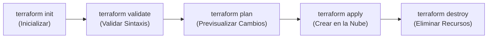

# 💻 Guía de Comandos Esenciales de Terraform

Esta guía reúne los comandos principales de **Terraform CLI**, su propósito técnico, sintaxis y ejemplos prácticos para administrar el ciclo de vida de la infraestructura de **IaC Asistencia**.

---

## 🔄 1. Ciclo de Vida Básico (El Flujo Principal)



### 1.1 `terraform init` (Inicialización)
Descarga los proveedores definidos en el código (en este caso el plugin de AWS de HashiCorp) y prepara el directorio de trabajo local `.terraform/`.
```bash
terraform init
```
* **Cuándo usarlo:** La primera vez que clonas el repositorio o cada vez que agregues un nuevo proveedor o módulo.
* **Flag útil:** `terraform init -upgrade` actualiza los proveedores a la versión más reciente permitida por las restricciones.

---

### 1.2 `terraform validate` (Validación Estática)
Verifica que los archivos `.tf` no tengan errores de sintaxis, variables sin declarar, tipos de datos incompatibles o referencias rotas entre recursos.
```bash
terraform validate
```
* **No requiere conexión con AWS ni credenciales.** Se ejecuta 100% en local.
* **Respuesta esperada:** `Success! The configuration is valid.`

---

### 1.3 `terraform fmt` (Formato y Estilo)
Revisa y formatea automáticamente todos los archivos de configuración `.tf` para que sigan las convenciones oficiales de sangría, alineación y estilo de HashiCorp.
```bash
# Formatea y sobrescribe los archivos necesarios
terraform fmt

# Solo revisa sin modificar (devuelve código de error si hay archivos sin formato, ideal para CI/CD)
terraform fmt -check
```

---

### 1.4 `terraform plan` (Planificación / Dry-Run)
Compara el código local con el estado real de la infraestructura en AWS y genera un plan de ejecución detallado.
```bash
terraform plan
```
* **Modo simulación:** Muestra qué recursos se van a crear (`+`), modificar (`~`) o destruir (`-`) **sin aplicar ningún cambio ni generar ningún cobro**.
* **Guardar un plan:** Para garantizar que `apply` ejecute exactamente lo planificado:
  ```bash
  terraform plan -out=tfplan
  ```

---

### 1.5 `terraform apply` (Despliegue y Aprovisionamiento)
Aplica los cambios en la nube y crea los recursos físicos reales (VPC, subredes, cortafuegos, servidores EC2).
```bash
# Solicita confirmación manual escribiendo 'yes'
terraform apply

# Despliegue automático sin confirmación interactiva
terraform apply -auto-approve

# Aplicar un plan previamente guardado
terraform apply tfplan
```

---

### 1.6 `terraform destroy` (Destrucción y Limpieza de Recursos)
Elimina **todos** los recursos gestionados por este proyecto en tu cuenta de AWS.
```bash
# Con confirmación interactiva
terraform destroy

# Eliminación directa sin confirmación
terraform destroy -auto-approve
```
* **Uso recomendado:** Ejecútalo al finalizar tus demostraciones o sesiones de estudio para detener de inmediato el consumo de horas y gigabytes de la capa gratuita (Free Tier).

---

## 🔍 2. Comandos de Inspección y Consulta

### 2.1 `terraform output` (Consultar Salidas)
Muestra los valores de salida configurados en `outputs.tf` (IPs, URLs, comandos SSH):
```bash
# Ver todas las salidas
terraform output

# Ver una salida específica en texto plano
terraform output -raw frontend_web_url
terraform output -raw frontend_public_ip
terraform output -raw backend_private_ip
```

### 2.2 `terraform state list` (Listar Recursos en el Estado)
Muestra todos los recursos que Terraform está gestionando activamente en este momento:
```bash
terraform state list
```
*Ejemplo de salida:*
```text
aws_instance.backend_server
aws_instance.frontend_server
aws_internet_gateway.igw
aws_network_acl.backend_nacl
aws_network_acl.frontend_nacl
aws_route_table.app_route_table
aws_security_group.backend_sg
aws_security_group.frontend_sg
aws_subnet.backend_subnet
aws_subnet.frontend_subnet
aws_vpc.main_vpc
```

### 2.3 `terraform state show` (Detalle de un Recurso Específico)
Muestra todos los atributos de un recurso en particular tal como existen en la nube:
```bash
terraform state show aws_instance.frontend_server
```

### 2.4 `terraform show` (Estado Completo en Texto Legible)
Muestra la totalidad del estado actual de todos los recursos en formato legible para humanos:
```bash
terraform show
```

### 2.5 `terraform refresh` (Sincronización de Estado)
Actualiza el archivo de estado local consultando el estado real de los recursos en AWS sin modificar nada:
```bash
terraform refresh
```

---

## 🎯 3. Comandos con Alcance Específico (*Targeting*)

Si solo deseas planificar o aplicar cambios sobre un recurso en específico sin tocar el resto:
```bash
# Planificar solo las instancias
terraform plan -target=aws_instance.frontend_server

# Aplicar solo el grupo de seguridad
terraform apply -target=aws_security_group.backend_sg -auto-approve
```

---

## 🐛 4. Depuración y Logs Detallados

Si un comando se queda esperando o falla por motivos de red o permisos de AWS, puedes activar el registro de depuración:

* **En PowerShell:**
  ```powershell
  $env:TF_LOG="INFO"
  terraform plan
  ```
* **En Git Bash / Linux / macOS:**
  ```bash
  export TF_LOG="INFO"
  terraform plan
  ```
* **Niveles disponibles:** `TRACE` (máximo detalle), `DEBUG`, `INFO`, `WARN`, `ERROR`.
* **Para desactivar los logs:**
  ```powershell
  $env:TF_LOG=""
  ```

---

## 📊 5. Generar Grafo Visual de Dependencias

Terraform calcula automáticamente qué recurso debe crearse antes que otro. Puedes exportar ese grafo en formato DOT (Graphviz):
```bash
terraform graph > graph.dot
```
*(Puedes pegar el contenido de `graph.dot` en herramientas online como [GraphvizOnline](https://dreampuf.github.io/GraphvizOnline/) para ver el diagrama de la arquitectura).*

---

## 🛡️ 6. Resumen Rápido de Comandos de Operación

| Tarea | Comando |
| :--- | :--- |
| **Primer paso al clonar** | `terraform init` |
| **Comprobar errores antes de subir** | `terraform validate` |
| **Dar formato al código** | `terraform fmt` |
| **Simular qué va a ocurrir en AWS** | `terraform plan` |
| **Crear toda la infraestructura** | `terraform apply -auto-approve` |
| **Ver las IPs asignadas** | `terraform output` |
| **Borrar todo para que AWS quede en $0** | `terraform destroy -auto-approve` |
