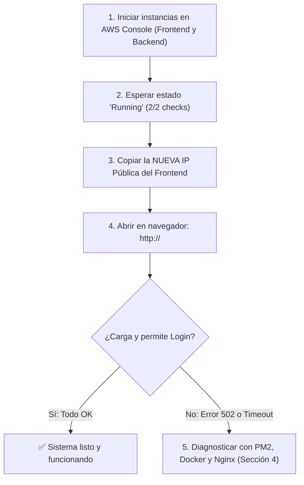

# 🔄 Guía de Re-levantamiento de Servidores EC2 (Stop & Start)

Esta guía explica el procedimiento rápido para **reanudar y verificar** los servicios del sistema **IaC Asistencia** después de haber **detenido (`Stop`)** y **vuelto a encender (`Start`)** las instancias EC2 en AWS para ahorrar horas de computación.

---

## 💡 Conceptos Clave que Debes Conocer

Cuando detienes (*Stop*) y luego inicias (*Start*) tus servidores en AWS EC2:

1. **🔄 La IP Pública del Frontend CAMBIA**:  
   Como no usamos IP Elástica (para mantener la política de **costo cero** en la Capa Gratuita), AWS libera la IP pública anterior y te asigna una **nueva IP pública** dinámica cada vez que enciendes la instancia.
2. **🔒 Las IPs Privadas NO CAMBIAN**:  
   Dentro de tu VPC, las direcciones IP privadas (`10.0.1.x` y `10.0.2.x`) se conservan idénticas mientras la instancia no sea destruida o terminada.  
   *(Esto significa que **no necesitas recompilar el frontend ni modificar la IP del backend en Nginx**).*
3. **💾 Los Datos y Programas SE CONSERVAN**:  
   Todo lo instalado (Node.js, Docker, Nginx, repositorios, dependencias, compilaciones y la base de datos PostgreSQL con sus usuarios) permanece intacto en los discos EBS.

---

## 📋 Resumen del Flujo de Reanudación



---

## 🚀 Paso 1: Encender las Instancias en AWS

1. Ingresa a la **Consola de AWS** y asegúrate de estar en la región **Ohio (`us-east-2`)**.
2. Ve al servicio **EC2** $\rightarrow$ **Instancias**.
3. Selecciona ambas instancias:
   * `iac-asistencia-backend`
   * `iac-asistencia-frontend`
4. Haz clic en **Estado de la instancia** (*Instance state*) $\rightarrow$ **Iniciar instancia** (*Start instance*).
5. Espera unos 1 a 2 minutos hasta que ambas muestren:
   * **Estado:** `Ejecutándose` (*Running*).
   * **Comprobación de estado:** `2/2 comprobaciones superadas` (*2/2 checks passed*).

---

## 🔍 Paso 2: Obtener la Nueva IP Pública del Frontend

Tienes dos métodos para conocer la nueva IP asignada:

### Opción A: Desde la Consola de AWS (Recomendada)
1. En la lista de instancias de EC2, selecciona `iac-asistencia-frontend`.
2. En la pestaña inferior **Detalles**, busca y copia la **Dirección IPv4 pública** (ejemplo: `18.222.45.120`).

### Opción B: Desde tu Terminal Local (con Terraform)
Si tienes PowerShell en tu máquina local dentro de la carpeta `terraform`:
```powershell
cd terraform
terraform refresh
terraform output frontend_public_ip
```

---

## 🌐 Paso 3: Verificación Rápida (Acceso Web)

Si en el despliegue inicial configuraste los servicios con persistencia (`pm2 startup` y `docker restart: always`), todo debería levantarse de manera 100% automática:

1. Abre tu navegador e ingresa a la nueva IP:
   ```text
   http://<NUEVA_IP_PUBLICA>
   ```
2. Inicia sesión con las credenciales de administrador:
   * **Email:** `admin@sistema.com` (o `admin@uagrm.edu.bo`)
   * **Contraseña:** `admin123`

Si la pantalla carga y puedes ver el panel de asistencia, **¡el sistema está completamente operativo!**

---

## 🛠️ Paso 4: Diagnóstico y Re-levantamiento Manual (Si algo no responde)

Si al ingresar al navegador recibes un error **502 Bad Gateway**, pantalla en blanco o no conecta, sigue estos pasos de diagnóstico en cada servidor.

> [!IMPORTANT]
> **Permisos de la Clave SSH en Windows:**  
> Recuerda que tu clave privada requiere permisos exclusivos en PowerShell:
> ```powershell
> icacls.exe ".\iac-asistencia.pem" /reset
> icacls.exe ".\iac-asistencia.pem" /grant:r "$($env:USERNAME):(R)"
> icacls.exe ".\iac-asistencia.pem" /inheritance:r
> ```

---

### 🖥️ 4.1. Diagnosticar el Servidor Backend (Base de Datos y API NestJS)

El backend debe estar activo primero para que el frontend pueda autenticar usuarios.

#### 1. Conéctate por SSH al Backend (usando el Frontend como Salto):
* **Desde PowerShell en Windows:**
  ```powershell
  ssh -i .\iac-asistencia.pem -o "ProxyCommand=ssh -i .\iac-asistencia.pem -W %h:%p ubuntu@<NUEVA_IP_PUBLICA_FRONTEND>" ubuntu@<IP_PRIVADA_BACKEND>
  ```
* **Desde Linux / macOS / Git Bash:**
  ```bash
  ssh -i ./iac-asistencia.pem -J ubuntu@<NUEVA_IP_PUBLICA_FRONTEND> ubuntu@<IP_PRIVADA_BACKEND>
  ```

#### 2. Verificar la Base de Datos PostgreSQL (Docker):
Revisa si el contenedor está encendido:
```bash
docker ps
```
* **Si no aparece en la lista**, inícialo con:
  ```bash
  docker start iac-asistencia-db
  ```
  *(O entra al proyecto y ejecútalo con `cd ~/iac-asistencia && docker compose up -d postgres`)*

* Comprueba que responda:
  ```bash
  docker exec iac-asistencia-db pg_isready -U postgres
  # Debe responder: "accepting connections"
  ```

#### 3. Verificar la API NestJS (PM2):
Revisa el estado de la aplicación Node:
```bash
pm2 status
```
* **Caso 1: Aparece como `online`:**  
  La API está corriendo correctamente.
* **Caso 2: Aparece como `errored` o `stopped`:**  
  Reiníciala con:
  ```bash
  pm2 restart asistencia-backend
  ```
* **Caso 3: La tabla de PM2 está vacía (no se restauró en el boot):**  
  Restaura los procesos guardados o levántala directamente:
  ```bash
  # Intento 1: Restaurar sesión previa de PM2
  pm2 resurrect

  # Si sigue vacía, iniciar manualmente desde la carpeta compilada:
  cd ~/iac-asistencia/backend
  pm2 start dist/main.js --name "asistencia-backend"
  pm2 save
  ```

#### 4. Probar la API localmente en el Backend:
```bash
curl http://localhost:3000/api/v1
```
Debe responder el endpoint de bienvenida de NestJS. Una vez verificado, escribe `exit` para salir del backend.

---

### 🌐 4.2. Diagnosticar el Servidor Frontend (Next.js y Nginx)

#### 1. Conéctate por SSH al Frontend:
```powershell
ssh -i .\iac-asistencia.pem ubuntu@<NUEVA_IP_PUBLICA_FRONTEND>
```

#### 2. Verificar el Servidor Web Nginx:
```bash
sudo systemctl status nginx
```
* Si está inactivo o en fallo (*inactive / failed*):
  ```bash
  sudo nginx -t                # Verifica que no haya errores de sintaxis
  sudo systemctl restart nginx
  ```

#### 3. Verificar la Aplicación Next.js (PM2):
```bash
pm2 status
```
* **Caso 1: Aparece como `online`:**  
  Next.js está activo en el puerto local 3001.
* **Caso 2: Aparece como `errored`:**  
  ```bash
  pm2 restart asistencia-frontend
  ```
* **Caso 3: La tabla de PM2 está vacía:**  
  ```bash
  # Intento 1:
  pm2 resurrect

  # Si sigue vacía, iniciar Next.js en puerto 3001:
  cd ~/iac-asistencia/frontend
  pm2 start npm --name "asistencia-frontend" -- start -- -p 3001
  pm2 save
  ```

#### 4. Probar Next.js localmente en el Frontend:
```bash
curl http://localhost:3001
```
Debe devolver el código HTML de la aplicación. Escribe `exit` para desconectarte.

---

## 🔒 Paso 5: Cómo Dejar el Auto-inicio 100% Blindado (Configurar una sola vez)

Si al reiniciar las máquinas tuviste que levantar PM2 manualmente, significa que faltó registrar el servicio en `systemd`. Para que **nunca más** tengas que ejecutar comandos manuales al encender las instancias:

### En el Servidor Backend:
```bash
# 1. Asegúrate que Docker se inicie con el sistema
sudo systemctl enable docker

# 2. Guarda el estado actual de los procesos de PM2
pm2 save

# 3. Genera el script de inicio de systemd
pm2 startup systemd -u ubuntu --hp /home/ubuntu
```
> [!NOTE]
> `pm2 startup` imprimirá en consola una línea de comando que empieza con `sudo env PATH=...`. Cópiala, pégala en la terminal y presiona Enter para registrar el servicio permanentemente.

### En el Servidor Frontend:
```bash
# 1. Asegúrate que Nginx se inicie con el sistema
sudo systemctl enable nginx

# 2. Guarda el estado actual de Next.js en PM2
pm2 save

# 3. Genera el script de inicio de systemd
pm2 startup systemd -u ubuntu --hp /home/ubuntu
```
*(Copia y ejecuta la línea con `sudo` que te muestre en pantalla).*

Con esto configurado, cada vez que enciendas las instancias desde la consola de AWS, **todos los servicios arrancarán de forma completamente autónoma en 60 segundos**.

---

## 🚦 Paso 6: Matriz Rápida de Solución de Problemas

| Síntoma en el Navegador / Terminal | Causa Probable | Comando de Solución |
| :--- | :--- | :--- |
| **`502 Bad Gateway` al entrar a `/`** | Next.js en el frontend (puerto 3001) está detenido. | En Frontend: `pm2 restart asistencia-frontend` |
| **`502 Bad Gateway` al hacer Login o peticiones `/api/`** | NestJS en el backend (puerto 3000) está detenido o no responde. | En Backend: `pm2 restart asistencia-backend` |
| **Error en consola: `Connection refused` a PostgreSQL (5432)** | El contenedor Docker de la base de datos está detenido. | En Backend: `docker start iac-asistencia-db` |
| **El navegador se queda esperando (*Timeout*)** | Usaste la IP pública antigua o los Security Groups no están asignados. | Copia la **nueva** IP pública de la consola de AWS. |
| **SSH rechaza la conexión con `Host key verification failed`** | La nueva IP pública perteneció antes a otro servidor en tus `known_hosts`. | En tu PC local: `ssh-keygen -R <NUEVA_IP_PUBLICA>` |
| **Nginx responde con la página por defecto de Ubuntu** | No se eliminó el enlace por defecto de Nginx. | En Frontend: `sudo rm -f /etc/nginx/sites-enabled/default && sudo systemctl restart nginx` |

---

## 🛑 Paso 7: Cómo Apagar las Instancias Correctamente (Ahorro de Costos)

Cuando termines tu sesión de trabajo o presentación:

1. Ve a la consola de **AWS EC2** $\rightarrow$ **Instancias**.
2. Selecciona ambas instancias (`iac-asistencia-backend` y `iac-asistencia-frontend`).
3. Ve a **Estado de la instancia** (*Instance state*) $\rightarrow$ **Detener instancia** (*Stop instance*).
4. **⚠️ NUNCA elijas "Terminar instancia" (*Terminate*)** a menos que desees borrar definitivamente los servidores y sus discos.
5. Al estar en estado **Detenido** (*Stopped*), AWS **no cobra por horas de cómputo de CPU ni memoria RAM**.
