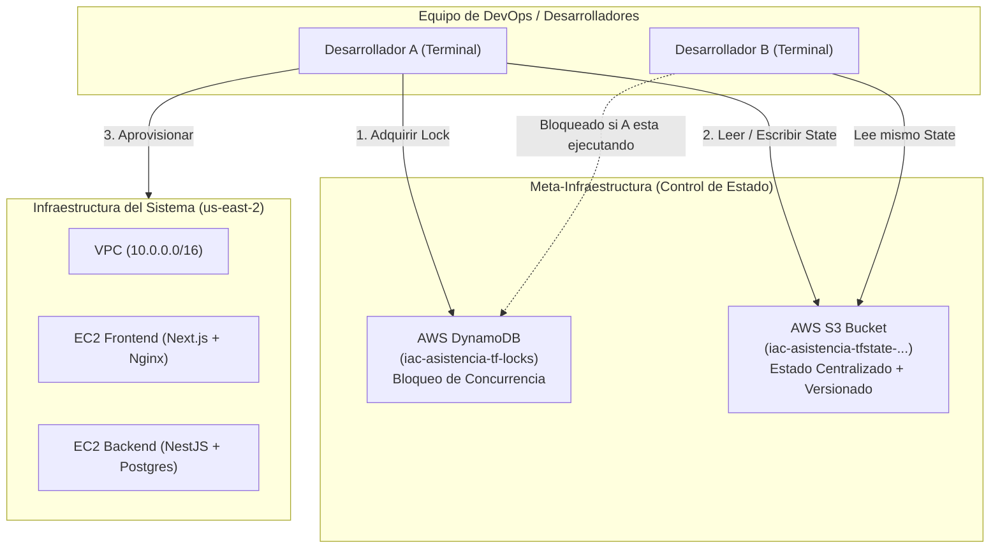

# ☁️ Guía de Configuración de Remote Backend en AWS S3 con DynamoDB Lock (Patrón Bootstrap y Migración)

Esta guía documenta detalladamente el procedimiento paso a paso para configurar un **Backend Remoto en Amazon S3** con **Bloqueo Concurrente en DynamoDB (*State Locking*)**, utilizando el **Patrón Bootstrap** para que un equipo de desarrollo pueda colaborar sobre la misma infraestructura sin conflictos ni subida de datos sensibles a Git.

---

## 🎯 1. ¿Por qué es necesario este procedimiento?

* **Estado Local (`terraform.tfstate`)**: Por defecto, Terraform guarda el estado en tu disco duro local. Si dos personas aplican cambios por separado, sus estados divergen y destruirán o duplicarán recursos.
* **Prohibido subir `.tfstate` a Git**: Contiene contraseñas, claves privadas y datos sensibles en texto plano.
* **Solución de Nivel DevOps**:
  * **Amazon S3**: Almacena el `terraform.tfstate` cifrado (`AES256`), con control de versiones y acceso público 100% bloqueado.
  * **Amazon DynamoDB**: Crea un cerrojo (*State Lock*). Si el Desarrollador A ejecuta `terraform apply`, nadie más del equipo puede ejecutar otro `apply` al mismo tiempo hasta que A termine.



---

## 🏗️ 2. Paso 1: Creación de la Meta-Infraestructura (Patrón Bootstrap)

Para evitar el dilema del **"huevo y la gallina"** (Terraform no puede usar un bucket S3 que aún no existe) y evitar que un `terraform destroy` en el proyecto borre por error el almacenamiento del estado, se crea una carpeta independiente llamada `bootstrap/`.

### Estructura de archivos creada en `bootstrap/`:
```text
bootstrap/
├── main.tf        # Define el Bucket S3, Versionado, Cifrado, Bloqueo Publico y Tabla DynamoDB
├── variables.tf   # Variables de region (us-east-2) y nombres unicos
└── outputs.tf     # Imprime el snippet exacto para copiar en el proyecto principal
```

### Contenido de `bootstrap/main.tf`:
```hcl
terraform {
  required_version = ">= 1.5.0"
  required_providers {
    aws = {
      source  = "hashicorp/aws"
      version = "~> 5.0"
    }
  }
}

provider "aws" {
  region = var.aws_region
}

# 1. Bucket S3 para almacenar el archivo terraform.tfstate
resource "aws_s3_bucket" "terraform_state" {
  bucket        = var.bucket_name
  force_destroy = false

  tags = {
    Name        = "Terraform State Storage"
    Environment = "Dev"
    Project     = "iac-asistencia"
  }
}

# 2. Habilitar Versionado en S3 para recuperacion ante desastres
resource "aws_s3_bucket_versioning" "terraform_state_versioning" {
  bucket = aws_s3_bucket.terraform_state.id

  versioning_configuration {
    status = "Enabled"
  }
}

# 3. Habilitar Cifrado del lado del servidor (SSE-S3)
resource "aws_s3_bucket_server_side_encryption_configuration" "terraform_state_crypto" {
  bucket = aws_s3_bucket.terraform_state.id

  rule {
    apply_server_side_encryption_by_default {
      sse_algorithm = "AES256"
    }
  }
}

# 4. Bloquear todo acceso publico al Bucket S3 (Seguridad)
resource "aws_s3_bucket_public_access_block" "terraform_state_public_block" {
  bucket = aws_s3_bucket.terraform_state.id

  block_public_acls       = true
  block_public_policy     = true
  ignore_public_acls      = true
  restrict_public_buckets = true
}

# 5. Tabla DynamoDB para Bloqueo de Estado Concurrente (State Locking)
resource "aws_dynamodb_table" "terraform_locks" {
  name         = var.dynamodb_table_name
  billing_mode = "PAY_PER_REQUEST" # Free Tier amigable (sin costo mensual)
  hash_key     = "LockID"

  attribute {
    name = "LockID"
    type = "S"
  }

  tags = {
    Name        = "Terraform State Lock Table"
    Environment = "Dev"
    Project     = "iac-asistencia"
  }
}
```

### Comandos ejecutados para crear el S3 y DynamoDB:
```bash
# 1. Entrar a la carpeta bootstrap
cd bootstrap

# 2. Inicializar los proveedores
terraform init

# 3. Aprovisionar el Bucket y la Tabla en AWS (us-east-2)
terraform apply -auto-approve
```

---

## 🛠️ 3. Alternativa Manual sin Terraform (Vía AWS CLI)

Si en lugar del código bootstrap prefieres crear estos dos recursos manualmente por línea de comandos, estos son los comandos equivalentes:

```bash
# 1. Crear el bucket en la region us-east-2
aws s3api create-bucket \
    --bucket iac-asistencia-tfstate-006635110928-us-east-2 \
    --region us-east-2 \
    --create-bucket-configuration LocationConstraint=us-east-2

# 2. Habilitar el control de versiones en el bucket
aws s3api put-bucket-versioning \
    --bucket iac-asistencia-tfstate-006635110928-us-east-2 \
    --versioning-configuration Status=Enabled

# 3. Bloquear todo el acceso publico
aws s3api put-public-access-block \
    --bucket iac-asistencia-tfstate-006635110928-us-east-2 \
    --public-access-block-configuration BlockPublicAcls=true,IgnorePublicAcls=true,BlockPublicPolicy=true,RestrictPublicBuckets=true

# 4. Crear la tabla de DynamoDB para bloqueo (Clave obligatoria LockID tipo String)
aws dynamodb create-table \
    --table-name iac-asistencia-tf-locks \
    --attribute-definitions AttributeName=LockID,AttributeType=S \
    --key-schema AttributeName=LockID,KeyType=HASH \
    --billing-mode PAY_PER_REQUEST \
    --region us-east-2
```

---

## 🔗 4. Paso 2: Configurar el Backend Remoto en el Proyecto Principal

En el archivo `terraform/main.tf`, dentro del bloque `terraform {}`, se agrega el backend apuntando a los recursos creados:

```hcl
terraform {
  required_version = ">= 1.5.0"
  required_providers {
    aws = {
      source  = "hashicorp/aws"
      version = "~> 5.0"
    }
  }

  backend "s3" {
    bucket         = "iac-asistencia-tfstate-006635110928-us-east-2"
    key            = "asistencia/terraform.tfstate"
    region         = "us-east-2"
    dynamodb_table = "iac-asistencia-tf-locks"
    encrypt        = true
  }
}
```

> [!NOTE]
> Recuerda que Terraform no permite usar variables (`var.xxx`) dentro del bloque `backend "s3"`, por lo que los valores van escritos como cadenas directas.

---

## 🚚 5. Paso 3: Migración del Estado Local a S3 (`-migrate-state`)

Como ya tenías infraestructura creada localmente (13 recursos en `terraform.tfstate`), ejecutamos la migración:

```bash
cd terraform
terraform init -migrate-state
```

*(Si lo ejecutas interactivamente, Terraform te preguntará `Do you want to copy existing state to the new backend? Enter "yes"`. También puedes usar `terraform init -migrate-state -force-copy` para aceptar automáticamente).*

### ¿Qué ocurrió internamente?
1. Terraform leyó los 13 recursos del archivo local `terraform.tfstate`.
2. Se conectó a Amazon S3 y subió el estado a `s3://iac-asistencia-tfstate-006635110928-us-east-2/asistencia/terraform.tfstate`.
3. Adquirió y liberó el bloqueo en la tabla DynamoDB `iac-asistencia-tf-locks`.
4. El archivo local `terraform/terraform.tfstate` quedó en **0 bytes** (vacío), y se creó una copia local previa de respaldo llamada `terraform.tfstate.backup`.

---

## 🔄 6. Paso 4: Refresh del Estado tras Parar y Encender Instancias

Cuando las instancias EC2 se detienen (*Stop*) y se vuelven a encender (*Start*), AWS les asigna una **nueva IP pública**.

Para actualizar el estado remoto en S3 con los datos reales de AWS sin alterar ninguna máquina:

```bash
cd terraform
terraform apply -refresh-only -auto-approve
```
*(O de forma equivalente: `terraform refresh`)*.

### Salida de la sincronización obtenida:
```text
Acquiring state lock. This may take a few moments...
...
  # aws_instance.frontend_server has changed
  ~ resource "aws_instance" "frontend_server" {
      ~ public_dns = "ec2-3-133-125-79.us-east-2.compute.amazonaws.com" -> "ec2-52-15-186-7.us-east-2.compute.amazonaws.com"
      ~ public_ip  = "3.133.125.79" -> "52.15.186.7"
    }

Changes to Outputs:
  ~ frontend_public_ip   = "3.133.125.79" -> "52.15.186.7"
  ~ frontend_web_url     = "http://3.133.125.79" -> "http://52.15.186.7"
  ~ ssh_connect_frontend = "ssh -i <tu-clave.pem> ubuntu@52.15.186.7"

Apply complete! Resources: 0 added, 0 changed, 0 destroyed.
```

---

## ✅ 7. Paso 5: Verificación y Auditoría de la Migración

Para comprobar que todo está funcionando perfectamente sobre S3:

### 1. Verificar el objeto en S3 con AWS CLI:
```bash
aws s3 ls s3://iac-asistencia-tfstate-006635110928-us-east-2/asistencia/ --region us-east-2
```
*Salida: `33311 terraform.tfstate` (archivo presente y con peso real).*

### 2. Listar los recursos leídos desde el remoto:
```bash
terraform state list
```
*Debe listar todos los componentes:*
* `aws_vpc.main_vpc`
* `aws_subnet.frontend_subnet` / `aws_subnet.backend_subnet`
* `aws_internet_gateway.igw`
* `aws_security_group.frontend_sg` / `aws_security_group.backend_sg`
* `aws_instance.frontend_server` / `aws_instance.backend_server`
* `aws_network_acl.frontend_nacl` / `aws_network_acl.backend_nacl`
* `aws_route_table.app_route_table` y sus asociaciones.

### 3. Ejecutar `terraform plan`:
```bash
terraform plan
```
*Salida:*
```text
Acquiring state lock. This may take a few moments...
No changes. Your infrastructure matches the configuration.
```

---

## 👥 8. ¿Cómo trabaja cualquier compañero del equipo a partir de ahora?

Cualquier colega que clone el repositorio:

1. Clona el proyecto y tiene sus credenciales de AWS configuradas en su terminal.
2. Entra a la carpeta del proyecto:
   ```bash
   cd terraform
   terraform init
   ```
3. Terraform descarga automáticamente el estado compartido desde S3.
4. Al correr `terraform plan`, verá que su infraestructura local ya conoce las instancias existentes, sin pisarse ni requerir enviarse archivos `.tfstate` por correo o chat.
